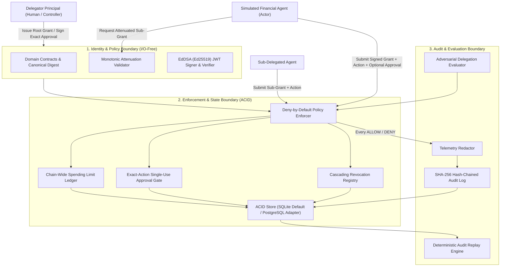
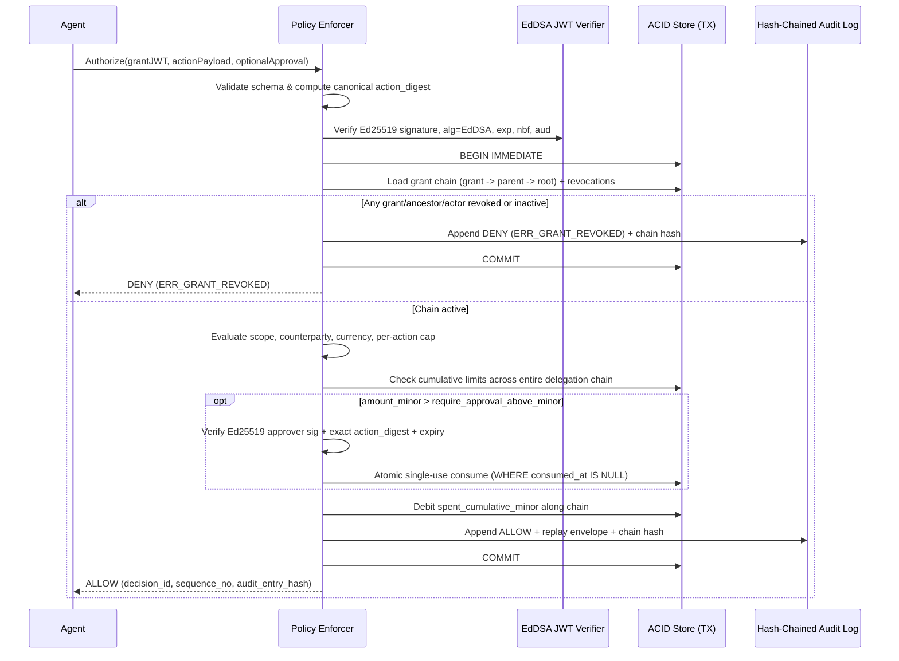

# Architecture — Agent Identity and Authorization Platform (AIAP)

## 1. System Overview and Trust Boundaries

AIAP enforces least-privilege, short-lived, auditable delegated authority for simulated financial agents across three strict boundaries:

1. **Identity & Policy Boundary (`src/domain`, `src/crypto`)** — Pure domain logic isolated from I/O. Defines principals, scopes, spending limits, canonical payload digests, monotonic delegation attenuation rules, and Ed25519 JOSE/JWT grant signing & verification.
2. **Enforcement & State Boundary (`src/enforcer`, `src/store`)** — Deny-by-default Policy Decision Point (PDP) and Policy Enforcement Point (PEP) backed by an ACID store (`SQLite` default, `PostgreSQL` adapter). Atomically checks grant chains, revocations, cumulative spending across the chain, and single-use exact-action approvals.
3. **Audit & Evaluation Boundary (`src/audit`)** — Redacted telemetry, SHA-256 hash-chained append-only audit ledger, deterministic decision replay engine, and seeded adversarial delegation evaluator.

## 2. Authorization and Revocation Linearizability Flow

To prevent TOCTOU revocation races and duplicate approval reuse, every `Authorize` and `Revoke` call executes within a serialized ACID transaction (`BEGIN IMMEDIATE` in SQLite; `SERIALIZABLE` / row locks in PostgreSQL):

## 3. Core Security Invariants

1. **No action outside scope or after revocation:** Every action must match an explicit scope allowlist, target audience, tenant, and counterparty constraint, and no grant, ancestor grant, actor, or delegator in the chain may be revoked.
2. **Monotonic attenuation (no delegation escalation):** Sub-delegations can only narrow or preserve permissions, audiences, counterparties, expiry, spending limits, and approval thresholds.
3. **Single-use exact-action approvals:** Approvals are cryptographically bound to the canonical SHA-256 digest of the exact action payload (`amount_minor`, `currency`, `counterparty_id`, `resource_id`, `action_type`, `audience`, `tenant_id`, `metadata`) and atomically consumed once.
4. **Every decision is traceable and replayable:** Both `ALLOW` and `DENY` decisions are persisted into a redacted, hash-chained audit log containing a deterministic replay envelope so historical decisions can be independently re-verified.
5. **Fail closed on uncertainty:** Missing configuration, unsupported algorithms, malformed tokens, clock violations, or unknown action types always produce `DENY` or explicit errors—never silent success.

## 4. Trade-Offs and Limitations

| Decision | Benefit | Trade-Off / Limitation |
|---|---|---|
| SQLite `BEGIN IMMEDIATE` default | Deterministic offline tests, strict revocation/approval linearizability | Global write lock per DB file; PostgreSQL adapter recommended for concurrent multi-node deployments |
| Short-lived stateless JWT + stateful registry | Cryptographic self-verification + instant revocation and cumulative limit tracking | Enforcement requires a store lookup rather than purely offline JWT verification |
| Exact-action digest over full payload | Eliminates amount/counterparty bait-and-switch attacks | Legitimate retries with modified metadata require a fresh approval |
| Fixed synthetic Ed25519 fixture keys | Reproducible tests and zero production secret exposure | Production systems require HSM/KMS-backed key custody and automated key rotation |
