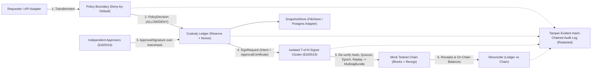

# Architecture — Digital Asset Custody Platform (Prototype)

> **Scope notice:** Independently developed educational/research prototype executing strictly in offline/mock-testnet mode. Never stores real private keys, customer records, or production funds.

## 1. Security Boundaries

The platform enforces strict separation across four operational boundaries so that compromise or misconfiguration of any single layer cannot authorize an unapproved transfer:

1. **Identity & Policy Boundary (`src/pkg/policy`)**
   - Stateless, deny-by-default evaluator against versioned JSON configuration (`config/default-policy.json`).
   - Enforces mock/testnet-only networks (hard-blocks `mainnet`/`production`), active vaults, asset/unit allowlists, destination allowlists with per-destination caps, single-transfer caps, UTC daily velocity caps, separation of duties (`RequestedBy` excluded from `EligibleApprovers`), and tiered approval quorums.
   - Binds every `PolicyDecision` to a SHA-256 `PolicyDigest` and `PolicyVersion`.

2. **Custody Ledger & Orchestration Boundary (`src/pkg/ledger`, `src/pkg/engine`)**
   - Pure domain double-entry balance engine (`ConfirmedBalance`, `ReservedBalance`, `AvailableBalance`) with an immutable `LedgerEntry` journal (`DEPOSIT`, `RESERVE`, `RELEASE`, `SETTLE`, `REORG_REVERT`).
   - Manages sequential per-vault nonces, replay detection, balance reservations, key-epoch invalidation of pre-signing pending intents, and chain reconciliation.
   - Holds **zero private signing keys** — only public keys for verification.

3. **Isolated Approval & Threshold Signer Boundary (`src/pkg/signer`)**
   - **Approver devices (`ApproverKeyring`)** sign domain-separated canonical `IntentHash` digests (`CUSTODY_APPROVAL_V1:...`) using Ed25519 (`crypto/ed25519`).
   - **Isolated signer nodes (`SignerNode` inside `MockMultisigCluster`)** operate as mock HSM/enclave nodes in a `T-of-N` threshold configuration (default 2-of-3).
   - Signer nodes have no access to mutable policy files or ledger balances. Before producing a partial signature (`CUSTODY_TX_V1:...`), every node independently re-verifies:
     - Canonical `TransferIntent` hash matches `ApprovalCertificate.IntentHash` in constant time (`crypto/subtle.ConstantTimeCompare`).
     - Intent `KeyEpoch` matches the node's active vault epoch.
     - Policy decision is `ALLOW` under the node's trusted `PolicyVersion`.
     - Approval quorum (`>= RequiredApprovals`) of distinct, non-requester, eligible Ed25519 approval signatures is valid.
     - Intent has not expired and neither `IntentID` nor `(VaultID, Nonce)` exists in the node's local replay cache.

4. **Mock Testnet Chain, Persistence & Audit Boundary (`src/pkg/chain`, `src/pkg/storage`, `src/pkg/audit`)**
   - **MockChain** deterministically simulates mempool acceptance (with multisig verification), block mining, confirmation depth, on-chain address balances, and chain reorganizations (both tx requeue and tx drop).
   - **AuditLog** records a hash-chained, tamper-evident log (`CUSTODY_AUDIT_V1:...`) with automatic redaction of sensitive key names and 128-hex key strings.
   - **SnapshotStore** provides atomic write-temp + rename persistence (`FileStore`) for crash-safe restart/rerun durability and a `database/sql` PostgreSQL adapter (`PostgresStore`) aligned with `config/schema.sql`.

## 2. Component & Data Flow Diagram

## 3. Core Invariants

1. **No unauthorized signing:** A `SignerNode` never signs unless `Intent.ComputeHash() == Certificate.IntentHash`, quorum of distinct non-requester Ed25519 approvals verifies, `KeyEpoch == ActiveEpoch`, intent is unexpired, and local replay checks pass.
2. **Intent hash binding:** Any post-approval mutation to `DestinationAddress`, `Amount`, `Asset`, `Nonce`, `KeyEpoch`, or `ExpiresAt` changes the SHA-256 canonical hash and fails closed with `ERR_INTENT_HASH_MISMATCH`.
3. **Accounting conservation & reconciliation:**
   - For every `(vault, asset)`: `ConfirmedBalance >= 0`, `ReservedBalance >= 0`, `AvailableBalance == ConfirmedBalance - ReservedBalance >= 0`.
   - `LedgerConfirmedBalance == OnChainConfirmedBalance`.
   - `LedgerReservedBalance == sum(amount of all intents holding active reservations)`.
4. **Epoch isolation on key rotation:** Rotating vault keys from epoch `E` to `E+1` permanently disables new signing under epoch `E`, invalidates pre-signing pending intents (`PENDING_APPROVAL`, `APPROVED`) with immediate balance unreservation, and retains epoch `E` public keys read-only so already-broadcast epoch `E` transactions still confirm and reconcile.
5. **Audit integrity & redaction:** `AuditLog.VerifyChain()` validates every sequential SHA-256 link from genesis; private keys and seeds are never serialized or logged.

## 4. Key Trade-offs

- **Isolated T-of-N Ed25519 partial signatures vs. threshold Schnorr/MPC (FROST/GG20):** Standard library `crypto/ed25519` provides audited, constant-time, zero-dependency cryptography ideal for a reproducible prototype, at the cost of producing `T` separate 64-byte signatures instead of a single aggregated threshold signature.
- **Deterministic mock seeds vs. hardware HSM RNG:** Fixtures use explicit `TESTNET_MOCK_SEED` inputs so runs are 100% reproducible byte-for-byte. Production custody would replace `SignerNode` key storage with FIPS 140-3 HSMs or hardware enclaves.
- **Offline FileStore + SQL schema vs. live PostgreSQL runtime:** Keeps local verification self-contained and offline-capable while preserving a clean relational schema (`config/schema.sql`) and `database/sql` adapter boundary.
