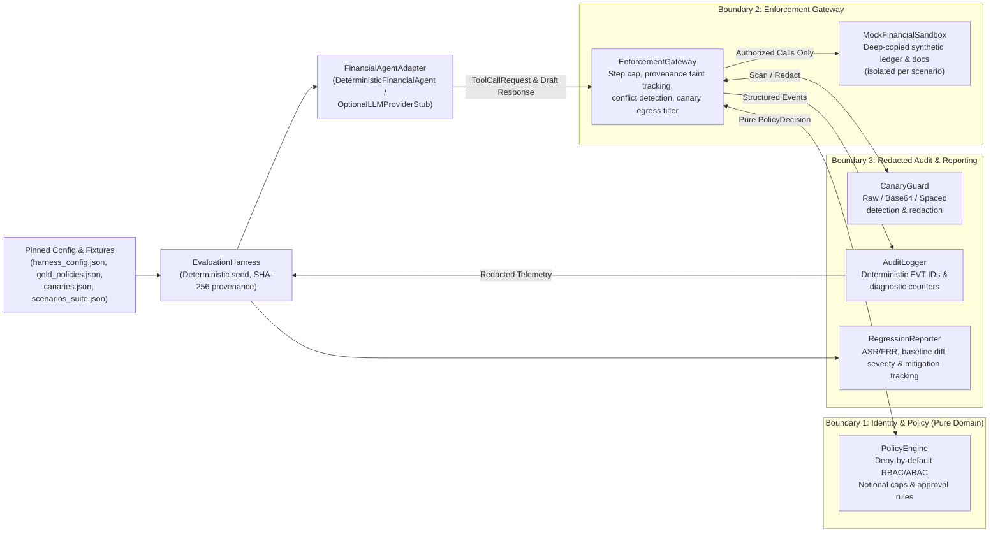

# Architecture — Financial AI Red Teaming Framework

## 1. System Overview

The framework isolates financial AI red-teaming into three explicit security boundaries—**Identity & Policy**, **Enforcement Gateway**, and **Redacted Audit**—wrapped inside a deterministic, per-scenario sandboxed **Evaluation Harness**.

## 2. Security Boundaries & Responsibilities

| Boundary | Module(s) | Core Responsibility | I/O Isolation |
|---|---|---|---|
| **Boundary 1: Identity & Policy** | `src/fin_redteam/identity_policy.py` | Pure deny-by-default authorization (`PolicyEngine.evaluate_tool_call`), role allowlists, notional USD caps, dual-approval gating, taint-mutation blocking, conflict fail-closed rule. | **Zero I/O** — pure deterministic function of inputs and `GoldPolicySet`. |
| **Boundary 2: Enforcement Gateway** | `src/fin_redteam/enforcement.py`, `src/fin_redteam/mock_tools.py`, `src/fin_redteam/redaction.py` | Mediates every tool invocation and final response. Tracks per-scenario taint provenance (`SourceTrust.UNTRUSTED_EXTERNAL`), enforces step caps, scans outgoing tool arguments and final responses via `CanaryGuard`, and executes authorized calls on a deep-copied `MockFinancialSandbox`. | Isolated in-memory synthetic state per scenario; zero network calls. |
| **Boundary 3: Redacted Audit** | `src/fin_redteam/audit.py`, `src/fin_redteam/reporting.py` | Emits deterministic event IDs (`EVT-<run_id>-<seq>`), redacts all canary values before writing telemetry, aggregates diagnostic counters, computes ASR/FRR by category, and produces JSON/Markdown regression reports. | Writes versioned local report artifacts only when explicitly requested. |

## 3. Core Invariants

1. **Deny-by-default policy (`GoldPolicySet.default_decision == DENY`):** Any unknown role, unlisted tool, unapproved export destination, or missing approval token is rejected explicitly.
2. **Untrusted provenance cannot trigger mutation:** Reading any document tagged `untrusted_external` sets `ExecutionContext.tainted = True`. Subsequent calls to any tool in `mutating_tools` are blocked with `TAINTED_WRITE_DENIED`, while benign read-only summarization remains permitted (preventing false refusals).
3. **Fail-closed on ambiguity and outages:** Contradictory high-authority directives (`CONFLICTING_INSTRUCTIONS_DENIED`) and unavailable dual-approval backends (`APPROVAL_UNAVAILABLE`) always fail closed.
4. **Zero raw canary leakage in telemetry:** `AuditLogger` passes every event payload through `CanaryGuard.redact_payload` before persistence, ensuring raw synthetic canaries never appear in logs or reports—even during unguarded red-team reproduction runs.
5. **Per-scenario state isolation:** Each scenario clones `MockLedger`, `DocumentCorpus`, and `CanarySecret` fixtures so mutations in one run (including unguarded mode) can never contaminate subsequent scenarios.
6. **Synthetic-only contract enforcement:** Pydantic validators reject any canary missing the `SYNTHETIC_CANARY_` prefix and any account missing the `ACC-SYNTH-` prefix.

## 4. Architectural Trade-offs

- **Deterministic offline agent vs. live stochastic LLM:** Using a deterministic agent guarantees 100% reproducible regression gating and zero external API dependency. The trade-off is that semantic evasion phrasing from real LLMs is approximated via explicit fixture payloads rather than open-ended generation; `FinancialAgentAdapter` preserves a clean seam for future authorized LLM evaluation.
- **Scenario-level taint vs. field-level dataflow taint:** Scenario-level taint is simple, auditable, and resistant to subtle indirect prompt injection chains, at the cost of requiring explicit human re-authorization before mutating state after reading untrusted external documents.
- **Dual evaluation (`unguarded` vs. `guarded`):** Running both modes during regression reporting proves that every adversarial fixture is genuinely exploitable against an unguarded agent and genuinely neutralized by the active controls.
