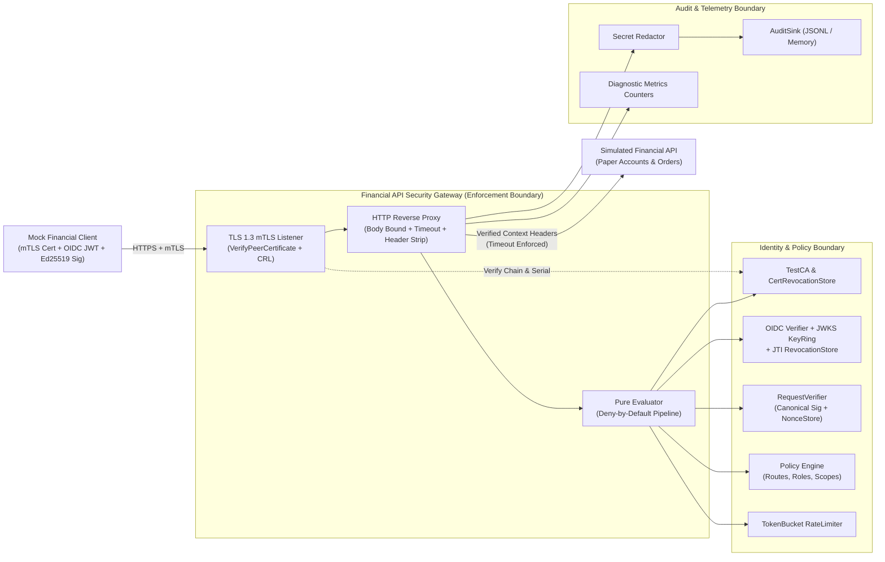
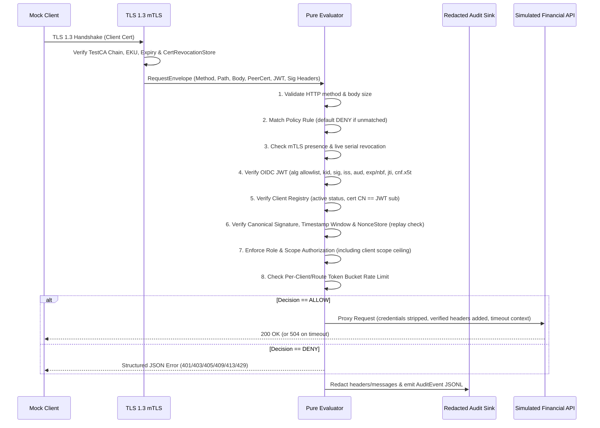

# Architecture — Financial API Security Gateway

## 1. Boundary Separation

The prototype enforces strict separation across four architectural boundaries so security decisions remain deterministic, testable without sockets, and auditable without secret exposure:

1. **Identity & Policy Boundary (`src/pki`, `src/oidc`, `src/policy`, `src/signing`)**
   - Manages local-lab X.509 Test CA issuance, certificate revocation (`CertRevocationStore`), OIDC JWKS key rotation (`KeyRing`), JWT revocation (`TokenRevocationStore`), client request-signing keys (`signing.KeyStore`), and deny-by-default authorization policies (`policy.Engine`).
2. **Pure Security Evaluation Boundary (`src/gateway/evaluator.go`)**
   - Stateless/injected-store state machine (`Evaluator.Evaluate`) completely isolated from HTTP/TLS I/O.
   - Accepts a transport-independent `domain.RequestEnvelope` and returns a deterministic `domain.EvaluationResult`.
   - Driven by an injected `domain.Clock` so every expiration, clock skew, nonce TTL, and token-bucket refill check is 100% reproducible.
3. **Enforcement & Proxy Boundary (`src/gateway/proxy.go`)**
   - Terminates TLS 1.3 mTLS (`tls.RequireAndVerifyClientCert` + live `VerifyPeerCertificate` revocation check).
   - Enforces request body size bounds, strips sensitive client credentials (`Authorization`, `X-Signature`, `X-Api-Key`, `Cookie`) before upstream forwarding, injects verified gateway identity headers (`X-Gateway-Verified-*`), and enforces strict upstream deadlines (`504 Gateway Timeout` on timeout).
4. **Redacted Audit & Diagnostics Boundary (`src/audit`)**
   - Deep-redacts sensitive headers, JWTs (`eyJ...`), Bearer strings, PEM private keys, and secret key-value patterns before writing immutable structured JSONL events (`AuditEvent`) and updating atomic diagnostic counters (`Metrics`).

## 2. Component Diagram

## 3. Request Verification Sequence

## 4. Security Invariants

1. **Fail-Closed / Deny-by-Default:** `gateway.json` fails validation if `deny_by_default` is `false`. Any unmatched route returns `403 ERR_POLICY_DEFAULT_DENY`.
2. **Proof-of-Possession Binding (RFC 8705):** Access tokens carry `cnf.x5t#S256` matching the mTLS leaf certificate SHA-256 thumbprint, and `sub` must equal the certificate `CN`. Presenting a stolen token over another client's mTLS certificate fails with `401 ERR_CERT_TOKEN_MISMATCH`.
3. **Explicit Algorithm Allowlisting:** OIDC verification permits only `EdDSA` and `ES256`, rejecting `alg: none` and `HS256` key-confusion attacks (`401 ERR_TOKEN_ALG_REJECTED`).
4. **Nonce DoS Resistance:** Nonces are recorded in `NonceStore` *only after* cryptographic signature verification succeeds, preventing unauthenticated callers from filling the nonce cache.
5. **Dual-Layer Certificate Revocation:** Revoked mTLS serial numbers are rejected both at TLS 1.3 handshake (`VerifyPeerCertificate`) and per-request inside `Evaluator` (covering already-open keep-alive connections).
6. **Zero Secret Persistence:** `audit.Redactor` runs on every audit event before serialization, scrubbing `Authorization`, `X-Signature`, `X-Api-Key`, `Cookie`, JWTs, PEM keys, and sensitive fields.

## 5. Key Trade-Offs

- **Pure Go Standard Library vs External Frameworks:** Eliminates third-party dependency drift and enables fully offline compilation and reproducible builds at the cost of implementing compact RFC 7517/7519 JWT/JWKS glue directly over `crypto/ed25519` and `crypto/ecdsa`.
- **In-Memory Stores behind Pluggable Interfaces vs Bundled Redis/PostgreSQL:** Keeps the local lab zero-dependency and deterministic for CI/developers while exposing clean Go interfaces (`NonceStore`, `Limiter`, `CertRevocationStore`, `TokenRevocationStore`, `Sink`) for distributed adapters.
- **No Production Key Management:** Test CA private keys and synthetic HMAC secrets exist only in memory/fixtures for local lab evaluation; production deployments require HSM/KMS-backed signers and distributed revocation infrastructure.
