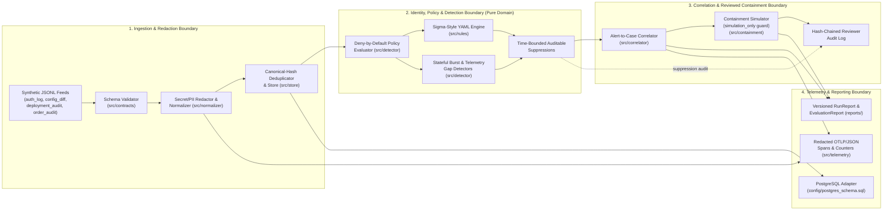

# Architecture — Trading Infrastructure Security Monitor (TISM)

## 1. System Overview

The Trading Infrastructure Security Monitor (TISM) is an offline defensive security lab prototype that ingests synthetic trading infrastructure telemetry, normalizes and redacts sensitive fields, detects unauthorized privilege/configuration/deployment/order anomalies using Sigma-style rules and stateful detectors, correlates alerts into evidence-backed cases, and produces reviewer-approved **simulation-only** containment proposals with a tamper-evident audit chain.

## 2. Trust and Responsibility Boundaries

1. **Identity and Policy Boundary (`config/policy.json`, `src/detector/policy.go`)**
   - Strict **deny-by-default** enforcement (`default_effect: "deny"`).
   - Configuration edits and deployments are denied unless an explicit `ApprovedChangeTicket` matches actor, service, approved file path or SHA-256 artifact digest, and UTC change window.
   - Suppressions are denied unless ticket-scoped, non-wildcard, time-bounded, justified, and signed by an authorized reviewer.
2. **Domain Detection Boundary (`src/rules`, `src/detector`, `src/correlator`)**
   - Completely isolated from filesystem, network, and database I/O.
   - Operates purely on canonical, redacted `NormalizedEvent` structs and deterministic timestamps so replay produces identical logical outputs.
3. **Enforcement / Simulation Boundary (`src/containment`)**
   - Hard-coded prohibition on automatic or live containment (`LiveExecutionEnabled = false`, `ExecuteLive()` always returns `ErrLiveContainmentProhibited`).
   - Requires authorized human review (`sec-reviewer-alice`, `sec-reviewer-bob`, `soc-lead-carol`), enforces separation of duties (no self-approval and no approval by the case actor), and requires dual control (2 distinct reviewers) for `critical` severity proposals.
4. **Audit and Telemetry Boundary (`src/normalizer/redactor.go`, `src/telemetry`, `src/containment`)**
   - Redaction happens *before* storage, detection, alerting, and OTLP telemetry export so raw secrets never enter logs, reports, or spans.
   - Reviewer decisions, containment simulations, and suppression activations are appended to a SHA-256 hash-chained `AuditRecord` ledger verified via `VerifyAuditChain()`.

## 3. Core Invariants

| Invariant | Enforcement Mechanism |
|---|---|
| Zero live containment | `MonitorConfig.Validate()` rejects `live_containment_enabled=true` or `containment_mode != "simulation_only"`; `Simulator.ExecuteLive()` unconditionally returns `ErrLiveContainmentProhibited`. |
| Complete alert provenance | Every `Alert` carries non-empty `SourceEventIDs`; every `Case` aggregates the sorted union of `AlertIDs` and `SourceEventIDs`. |
| Secret-free outputs | Field-name and regex redaction run inside `Normalizer.Normalize()` and on every `telemetry.Recorder` span attribute. |
| Deterministic reproducibility | Canonical hashing, lexicographic tie-breakers, fixed seed in `RunMetadata`, and deterministic `StableID` generation guarantee identical outputs across reruns and replays. |
| No silent failures | Invalid JSON lines, unsupported event types, missing configs, and missing telemetry sources all emit typed errors or explicit `TelemetryGap` / `ValidationErrorRecord` outputs. |

## 4. Design Trade-Offs

- **Zero external Go dependencies:** Using pure Go standard library keeps the offline defensive lab deterministic, fast, auditable, and free of third-party license/supply-chain friction. Trade-off: the Sigma YAML parser supports the Sigma rule subset needed here rather than full arbitrary YAML 1.2 anchors/merges, and the PostgreSQL adapter targets `database/sql` without bundling a network driver binary.
- **Content-addressed stable IDs vs UUIDv4:** Using SHA-256-derived `StableID`s (`ALT-...`, `CASE-...`, `PROP-...`) makes regression testing, baseline diffing, and replay verification exact, at the cost of requiring unique event IDs or timestamps to differentiate distinct occurrences.
- **Single-linkage clustering in correlation:** Union-Find within a configurable window (`900s`) reliably links multi-stage actor campaigns (login → privilege grant → config edit → order override) without complex graph ML dependencies; telemetry health alerts are intentionally partitioned so pipeline issues never merge into attacker cases.
